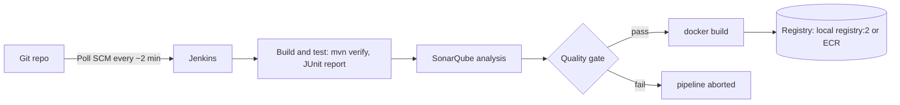

# Jenkins Pipeline: Git, Maven, Poll SCM, SonarQube and Docker

A Jenkins controller that is built entirely from files (Configuration as Code), watches a Git repository by polling it, and runs a
declarative pipeline: Maven build and tests, a SonarQube quality gate, a Docker image, and a push to a registry. Everything runs on
your machine with Docker Compose; pointing the push at Amazon ECR is a parameter change.

| | |
|---|---|
| Built with | Jenkins (LTS, JDK 17), Jenkins Configuration as Code, Job DSL, declarative Pipeline, Maven, JUnit, SonarQube, Docker, Docker Compose |
| Triggering | **Poll SCM** (`H/2 * * * *`): Jenkins checks Git itself, so no webhook or public URL is needed |
| App | the same small Java 17 HTTP service used in [aws-cicd-pipeline](https://github.com/dineshravichandiran/aws-cicd-pipeline) |
| Status | **written and syntax-checked; not yet run** (details below) |

## Pipeline

## What is in the repo
| Path | What it does |
|---|---|
| `Jenkinsfile` | the pipeline: stages, Poll SCM trigger, parameters (`REGISTRY`, `RUN_SONAR`), 20-minute timeout, one build at a time |
| `jenkins/Dockerfile`, `plugins.txt` | Jenkins image with a fixed plugin list and the Docker CLI |
| `jenkins/casc.yaml` | admin user, Maven tool, SonarQube server, token credential and the `greeter` job, all defined as code |
| `docker-compose.yml` | Jenkins + SonarQube Community + a local registry |
| `app/` | the Java app, its tests and its Dockerfile |

## Run it
1. `export JENKINS_ADMIN_PASSWORD='choose-one'` (do not commit it), then `docker compose up -d --build`.
2. Open SonarQube at http://localhost:9000, change the default password, create a token, then
   `export SONAR_TOKEN=...` and `docker compose up -d --force-recreate jenkins`. (To skip the gate, run the job with `RUN_SONAR` unticked.)
3. Open Jenkins at http://localhost:8080, run `greeter` once. After that, a new commit on `main` is picked up within about two minutes.
4. To push to ECR instead: set the `REGISTRY` parameter to your ECR repository URI and log the host Docker in with `aws ecr get-login-password`.

## Design notes and trade-offs
- **Poll SCM instead of a webhook.** A webhook needs Jenkins reachable from GitHub. Polling works behind a laptop or firewall at the cost of up to two minutes' delay and some idle checks.
- **Configuration as Code.** A rebuilt controller comes back identical. Secrets (admin password, Sonar token) come from environment variables, never from the repository.
- **Docker socket is mounted into Jenkins.** That is the simple way to build images, but anyone who can run a job can control the host's Docker. Fine for a personal lab; for shared use I would use a separate build agent or a daemonless builder such as Kaniko.
- **Plugins are not version-pinned** in `plugins.txt`, so a rebuild picks up newer ones. Pin them before relying on this.

## What was and was not checked
Done:
- `docker-compose.yml` and `casc.yaml` parse as valid YAML.
- The Java app compiles, and its logic and HTTP endpoints were exercised by hand (see the sibling project).

**Not done:**
- The stack has **not been started**: no Jenkins, SonarQube or registry container has run from these files.
- The `Jenkinsfile` has not been run or linted by Jenkins, so stage syntax and plugin step names are unverified.
- The Maven/JUnit tests have not been run by me (Maven Central was not reachable where I built this).
- No push to ECR was tried.
I will update this section with the real run once it has been done.
